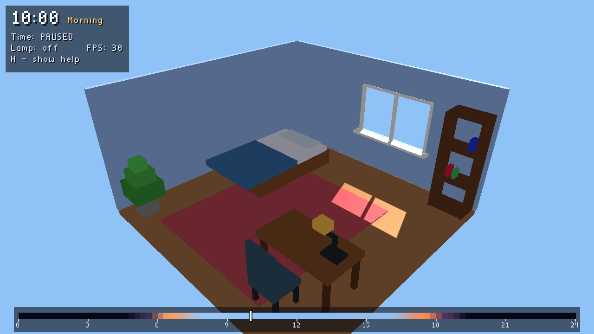
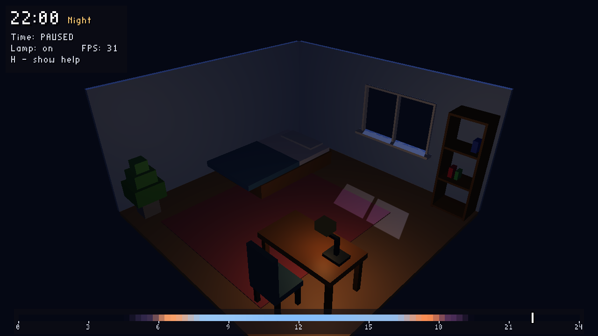
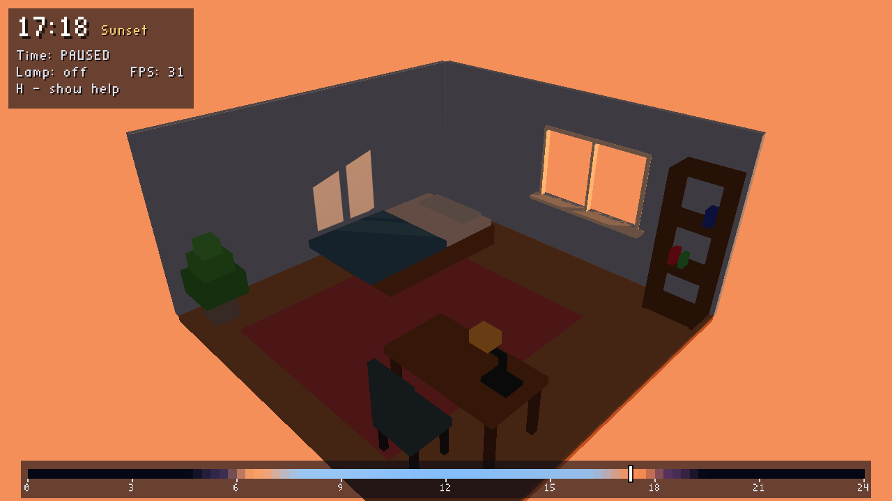
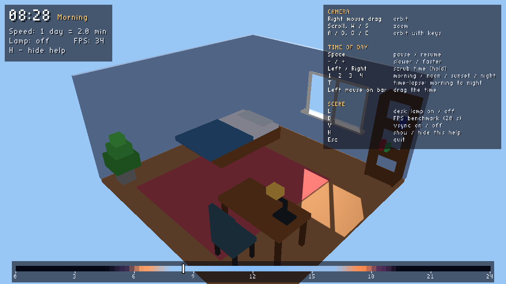

# Cozy Room

A real-time 3D diorama of a small bedroom that lives through a full day,
written in C++ with OpenGL 3.3 core.
Final project for Computer Graphics Fundamentals, Astana IT University
(topic 2: Cozy Room Diorama).




## Team

| Member  | Part |
|---------|------|
| Yessen  | Project setup, window, shaders, camera, lighting, empty room |
| Aidana  | Bed, bookshelf, rug, plant, textures |
| Aruzhan | Desk, chair, desk lamp and its light, scene graph |
| Baxa    | Day/night cycle, time controls, on-screen help, sun shadows, final checks |

## Build

Requirements: CMake 3.16+, a C++17 compiler, internet on the first build
(GLFW and GLM are downloaded by CMake). GLAD and stb_easy_font are included in `external/`.

```bash
cmake -S . -B build
cmake --build build
./build/CozyRoom            # Windows: build\Debug\CozyRoom.exe
```

VS Code: open the folder with the CMake Tools extension, then Build and Run.

Xcode:

```bash
cmake -S . -B build-xcode -G Xcode
open build-xcode/CozyRoom.xcodeproj
```

Linux: install the X11 development packages first
(`libx11-dev libxrandr-dev libxinerama-dev libxcursor-dev libxi-dev libgl-dev`).
If Wayland headers are missing, configure with `-DGLFW_BUILD_WAYLAND=OFF`.

## Controls

| Input | Action |
|-------|--------|
| Right mouse drag | Orbit around the room |
| Scroll, W / S | Zoom in / out |
| A / D | Orbit left / right |
| Q / E | Lower / raise the camera |
| Space | Pause / resume time |
| - / + | Time slower / faster (1 day = 6 s ... 8 min) |
| Left / Right (hold) | Scrub the time backwards / forwards |
| 1 / 2 / 3 / 4 | Jump to morning / noon / sunset / night |
| T | Time-lapse from 07:00 to 23:00 (the lamp switches on at 19:00) |
| Left mouse on the bottom bar | Drag the time slider |
| L | Desk lamp on / off |
| B | FPS benchmark (20 s) |
| V | Vsync on / off |
| H | Show / hide the help panel |
| Esc | Quit |

The clock, speed, lamp state and FPS are shown in the top-left corner;
the FPS is also in the window title.

## Features

Core (from the topic):

- [x] Room with furniture: bed, bookshelf with books, rug, plant, desk, chair, desk lamp
- [x] Sun light through the window, moving with a time slider
- [x] Desk lamp switched by a key (second light, point light with attenuation)
- [ ] Fairy lights switched by a key
- [ ] Textured walls and floor (with mipmaps)

Stretch goals:

- [x] Day/night cycle: the sun moves along an arc, the moon lights the room at night
- [x] Warm/cold colour change by time of day (sky, sun and ambient colours)
- [x] Shadow mapping for the sun, soft edges with 3x3 PCF
- [ ] Dust particles in the light beam

Wow moment: press **T** for a time-lapse from morning to night;
the sunlight patch crawls over the floor and the desk lamp switches on at 19:00.

Technical:

- [x] OpenGL 3.3 core profile, VAO/VBO/EBO, own GLSL shaders
- [x] Orbit camera, frame-rate independent
- [x] Per-fragment Blinn-Phong lighting
- [x] On-screen HUD with help (no font texture, text built from quads)
- [x] FPS counter and built-in benchmark
- [ ] Scene graph (parent-child transforms)

## How it works

**Day/night cycle** (`DayNight.cpp`). The clock runs from 0 to 24 hours. Between 06:00
and 18:00 the sun moves along an arc behind the back wall, rising on the left and setting
on the right; at night the moon follows the same arc. Sky, light and ambient colours
come from key frames (night, dawn, sunrise, morning, noon, afternoon, sunset, dusk) that
are blended smoothly. Near the horizon the light fades to zero, so the switch between
the sun and the moon is not visible. The lamp switches on at 19:00 and off at 07:00;
L still works at any time.

**Shadows** (`ShadowMap.cpp`, `shadow_depth.*`, `basic.frag`). Two passes per frame.
First the scene is drawn from the sun into a 2048x2048 depth texture with an orthographic
projection (the sun is far away, so its rays are parallel). Then `basic.frag` projects every
pixel into that texture and compares depths; 3x3 samples are averaged (PCF) for a soft edge.
Shadow acne is removed with front-face culling in the depth pass and a small slope-scaled bias.
The room is a cut-away, so a ceiling and a right wall are drawn **only into the shadow
map**: the camera can look in, but the sunlight enters only through the window.

**HUD** (`Hud.cpp`, `TimeControls.cpp`). A second, flat shader draws coloured
rectangles and text on top of the scene with alpha blending. Letters come from
stb_easy_font, which builds every character from small quads, so no font texture is needed.
The time slider is painted with the sky colour of every hour.

## Project structure

```
src/
  main.cpp           window, input, render loop
  Camera.*           orbit camera
  Shader.*           loads and compiles GLSL programs
  Mesh.*             VAO/VBO/EBO, cube mesh
  Room.*             room and furniture
  DayNight.*         time of day -> sun/moon direction and colours
  ShadowMap.*        depth framebuffer for the sun
  Hud.*              2D overlay: rectangles and text
  TimeControls.*     time keys, time slider, help panel
  Benchmark.*        FPS benchmark (key B)
shaders/
  basic.vert/.frag   Blinn-Phong + sun shadows + desk lamp
  shadow_depth.*     depth pass for the shadow map
  hud.vert/.frag     2D overlay
external/
  glad/              OpenGL loader
  stb/               stb_easy_font
```

## Performance

Measured with the built-in benchmark (key **B**): 20 seconds, vsync off, the camera
makes one full circle while the clock runs through a whole day. The program prints the
table row to the console.

| GPU | Resolution | Avg FPS | Min FPS | Avg frame time |
|-----|------------|---------|---------|----------------|
| llvmpipe (software rendering, no GPU) | 1280x720 | 35 | 20 | 28.52 ms |

The software-rendering row is the worst case (the CPU does all the GPU work).
Rows for the team's laptops are added after running the benchmark on them.

## Screenshots

| | |
|---|---|
|  |  |

Earlier progress screenshots are in `docs/screenshots/`.

## AI Use

We used Claude (Anthropic) as an assistant in this project.
For the day/night cycle, time controls, HUD, shadow mapping and benchmark, Claude helped
write and review the code; every part was built, run and checked by the team member
responsible for it.

## Credits

Libraries and references are listed in [CREDITS.md](CREDITS.md).
