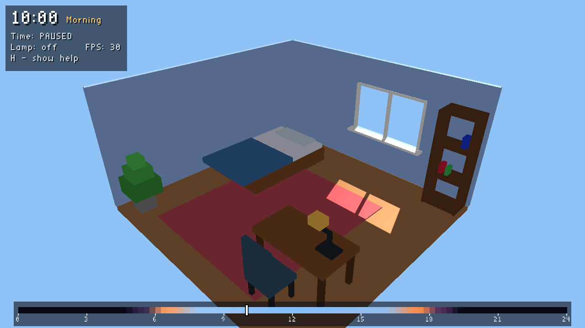
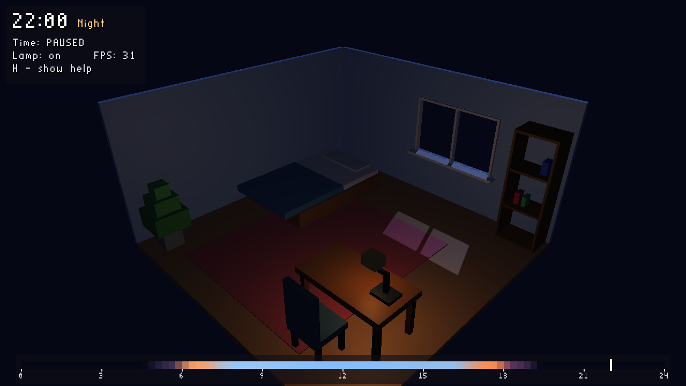
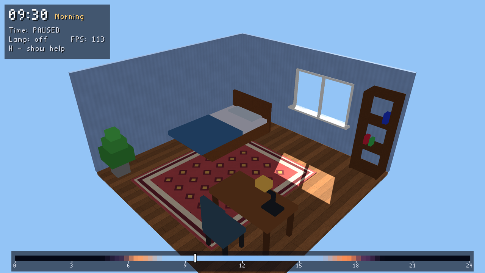
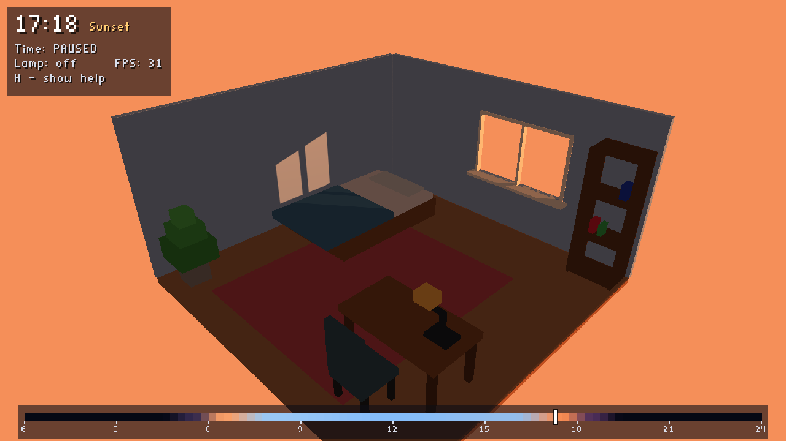
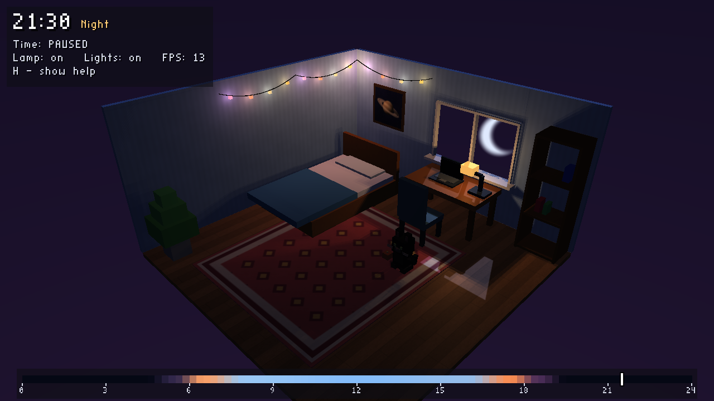
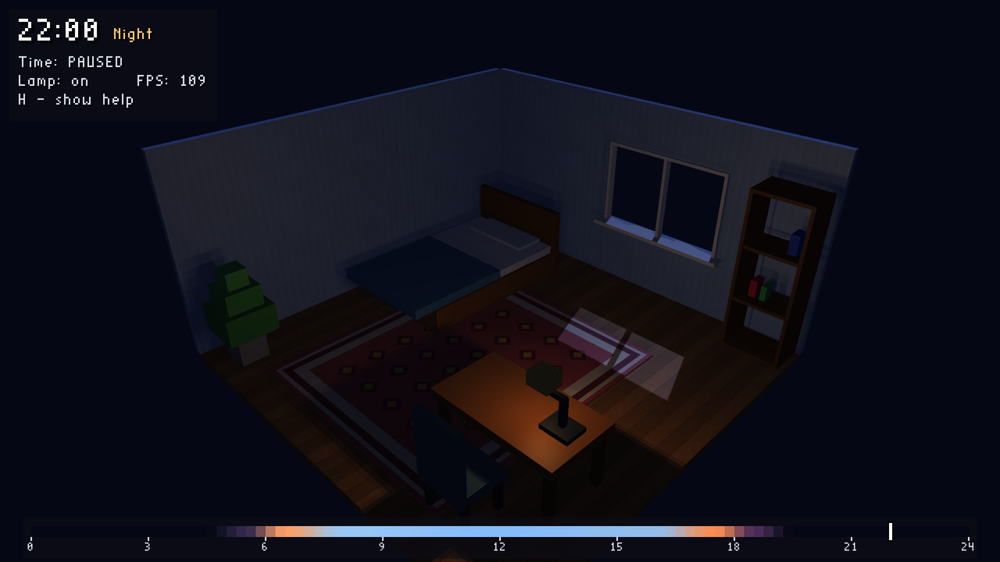

# Cozy Room

A real-time 3D diorama of a small bedroom that lives through a full day,
written in C++ with OpenGL 3.3 core.
Final project for Computer Graphics Fundamentals, Astana IT University
(topic 2: Cozy Room Diorama).




## Team

| Member  | Part |
|---------|------|
| Yessen  | Project setup, window, shaders, camera, lighting, empty room, desk lamp shadows (cube map), Saturn picture |
| Aidana  | Bed with headboard, bookshelf, rug, plant, `Texture` class, UVs and all textures |
| Aruzhan | Desk, chair, desk lamp and its light, scene graph (lamp arm, cat), laptop screen, procedural sky in the window |
| Baxa    | Day/night cycle, time controls, on-screen help, sun shadows, fairy lights, glowing lamp shade, release checks |

## Build

Requirements: CMake 3.16+, a C++17 compiler, internet on the first build
(GLFW and GLM are downloaded by CMake). GLAD, stb_easy_font and stb_image are included in `external/`.

```bash
cmake -S . -B build
cmake --build build
./build/CozyRoom            # Windows: build\Debug\CozyRoom.exe
```

VS Code: open the folder with the CMake Tools extension, then Build and Run.

Xcode:

```bash
cmake -S . -B build-xcode -G Xcode
open build-xcode/CozyRoom.xcodeproj
```

Linux: install the X11 development packages first
(`libx11-dev libxrandr-dev libxinerama-dev libxcursor-dev libxi-dev libgl-dev`).
If Wayland headers are missing, configure with `-DGLFW_BUILD_WAYLAND=OFF`.

## Controls

| Input | Action |
|-------|--------|
| Right mouse drag | Orbit around the room |
| Scroll, W / S | Zoom in / out |
| A / D | Orbit left / right |
| Q / E | Lower / raise the camera |
| Space | Pause / resume time |
| - / + | Time slower / faster (1 day = 6 s ... 8 min) |
| Left / Right (hold) | Scrub the time backwards / forwards |
| 1 / 2 / 3 / 4 | Jump to morning / noon / sunset / night |
| T | Time-lapse from 07:00 to 23:00 (the lamp switches on at 19:00) |
| Left mouse on the bottom bar | Drag the time slider |
| L | Desk lamp on / off |
| F | Fairy lights on / off |
| [ / ] | Turn the lamp arm |
| P | Laptop screen on / off |
| B | FPS benchmark (20 s) |
| V | Vsync on / off |
| H | Show / hide the help panel |
| Esc | Quit |

The clock, speed, lamp and fairy-light state and FPS are shown in the top-left corner;
the FPS is also in the window title.

## Features

Core (from the topic):

- [x] Room with furniture: bed, bookshelf with books, rug, plant, desk, chair, desk lamp
- [x] Sun light through the window, moving with a time slider
- [x] Desk lamp switched by a key (second light, point light with attenuation)
- [x] Fairy lights switched by a key (F): 12 small point lights over the bed, on by themselves at 19:00
- [x] Textured walls and floor (with mipmaps), plus a patterned rug and wood grain on the bed and bookshelf
- [x] Framed picture of Saturn above the bed (texture drawn by our own script)
- [x] A cat that moves around the room during the day, a laptop with a screen that turns on (P)
- [x] Procedural sky with the sun, moon and stars seen through the window

Stretch goals:

- [x] Day/night cycle: the sun moves along an arc, the moon lights the room at night
- [x] Warm/cold colour change by time of day (sky, sun and ambient colours)
- [x] Shadow mapping for the sun, soft edges with 3x3 PCF
- [x] Shadows from the desk lamp (cube-map shadow for a point light), e.g. under the desk
- [x] Dust particles drifting in the sunlight beam from the window (1,400 soft point sprites)

Wow moment: press **T** for a time-lapse from morning to night;
the sunlight patch moves across the floor, and dust motes shimmer in its beam; at 19:00 the desk lamp shade starts to glow
and the fairy lights come on one after another along the string.

Technical:

- [x] OpenGL 3.3 core profile, VAO/VBO/EBO, own GLSL shaders
- [x] Orbit camera, frame-rate independent
- [x] Per-fragment Blinn-Phong lighting
- [x] On-screen HUD with help (no font texture, text built from quads)
- [x] FPS counter and built-in benchmark
- [x] Scene graph (parent-child transforms): the lamp arm and shade follow the lamp base, the cat's parts follow its body
- [x] Emissive surfaces: the bulbs, the lamp shade when the lamp is on, the laptop screen

## How it works

**Day/night cycle** (`DayNight.cpp`). The clock runs from 0 to 24 hours. Between 06:00
and 18:00 the sun moves along an arc behind the back wall, rising on the left and setting
on the right; at night the moon follows the same arc. Sky, light and ambient colours
come from key frames (night, dawn, sunrise, morning, noon, afternoon, sunset, dusk) that
are blended smoothly. Near the horizon the light fades to zero, so the switch between
the sun and the moon is not visible. The lamp switches on at 19:00 and off at 07:00;
L still works at any time.

**Shadows** (`ShadowMap.cpp`, `shadow_depth.*`, `basic.frag`). Two passes per frame.
First the scene is drawn from the sun into a 2048x2048 depth texture with an orthographic
projection (the sun is far away, so its rays are parallel). Then `basic.frag` projects every
pixel into that texture and compares depths; 3x3 samples are averaged (PCF) for a soft edge.
Shadow acne is removed with front-face culling in the depth pass and a small slope-scaled bias.
The room is a cut-away, so a ceiling and a right wall are drawn **only into the shadow
map**: the camera can look in, but the sunlight enters only through the window.

**Lamp shadows** (`PointShadowMap.cpp`, `point_shadow.*`, `basic.frag`). The desk lamp is a
point light, so it shines in every direction and one flat shadow map is not enough. While
the lamp is on, the scene is drawn six times from the bulb into the faces of a depth cube map
(90 degree field of view each); every texel stores the distance from the lamp to the closest
surface. `basic.frag` looks the cube map up with the direction from the lamp to the pixel and
compares the two distances, averaging 8 samples for a soft edge. The lamp's own parts are left
out of this pass, because the bulb sits inside the shade. The desk top now blocks the light,
so the floor under the desk stays dark at night.

**Textures** (`Texture.cpp`, `basic.vert`, `basic.frag`). Images are loaded with stb_image,
uploaded once at start-up and given mipmaps (`glGenerateMipmap`) with trilinear filtering
(`GL_LINEAR_MIPMAP_LINEAR`) and `GL_REPEAT`. Every cube face has UVs from 0 to 1; the vertex
shader multiplies them by the size of that face divided by the tile size, so one 1 m tile
repeats 6 times on the 6 m floor and the texture is never stretched. The colour texture
uses unit 0 (the shadow map is on unit 1) and is multiplied by the object colour, so the
same wallpaper or wood grain can be tinted per object. The textures themselves are made
by `tools/make_textures.py`.

**Scene graph** (`Room.h`, `Room.cpp`, `RoomCat.cpp`). A `SceneNode` keeps a local transform
and a list of children; the world matrix of a part is its parent's world matrix times its own
local matrix. The lamp is a chain base → stem → pivot → arm → shade: `[` and `]` rotate the pivot,
and the arm, the shade and the light position all follow. The light position is read from the
shade's world matrix, so the light always stays inside the shade.

**Fairy lights** (`FairyLights.cpp`, `basic.frag`). The string hangs from hooks 10 cm in front
of the back and left walls; between two hooks the wire sags like a parabola,
y = y0 − 4·sag·t(1 − t). Each of the 12 bulbs is a point light: `basic.frag` adds a diffuse term
with a fast fall-off, 1 / (1 + d + 2.5 d²), so a bulb only lights the wall and the bed close to it.
Bulbs are not shadowed (12 more cube maps would cost too much for such small lights). When the
string switches on, bulb *i* starts after 0.12·*i* s, so a wave runs along it, and every bulb
twinkles slightly. When all bulbs are dark the shader loop is skipped.

**Glowing surfaces** (`uEmissive` in `basic.frag`). An emissive colour is added after all
lighting, so a surface can glow on its own: the bulbs, the lamp shade while the lamp is on, and
the laptop screen. Everything else sends black.

**Dust in the sunlight** (`DustParticles.cpp`, `dust.vert`, `dust.frag`). The renderer creates
1,400 point sprites in a narrow volume in front of the window. The vertex shader gives each mote
a slow, independent drift and scales its size with camera distance; the fragment shader fades the
edges into a soft warm speck. Alpha blending makes the particles translucent, and their brightness
follows the daylight, so they fade out when the sun is below the horizon. They are drawn only in
the room's sunlit window beam and do not cast shadows.

**HUD** (`Hud.cpp`, `TimeControls.cpp`). A second, flat shader draws coloured
rectangles and text on top of the scene with alpha blending. Letters come from
stb_easy_font, which builds every character from small quads, so no font texture is needed.
The time slider is painted with the sky colour of every hour.

## Project structure

The project is a C++17/CMake application. All application code is under `src/`; CMake adds each
`.cpp` file automatically, while the renderer loads GLSL programs and textures from their own
folders at runtime.

```
CMakeLists.txt
CREDITS.md
src/
  main.cpp                 window, input, render loop and feature integration
  Camera.h/.cpp            orbit camera
  Shader.h/.cpp            GLSL compile, link and uniforms
  Mesh.h/.cpp              VAO/VBO/EBO and cube geometry
  Texture.h/.cpp           image loading, mipmaps and texture binding
  Room.h/.cpp              room, furniture, materials and lamp scene graph
  RoomCat.cpp              cat geometry and time-based activities
  DayNight.h/.cpp          clock, sun/moon direction and lighting keyframes
  ShadowMap.h/.cpp         directional shadow map for the sun
  PointShadowMap.h/.cpp    depth cube map for the desk lamp
  FairyLights.h/.cpp        hanging wire, bulbs and point-light uniforms
  DustParticles.h/.cpp     translucent motes in the sunlight beam
  WindowSky.h/.cpp         procedural sky and window pane
  Hud.h/.cpp               2D HUD primitives and text
  TimeControls.h/.cpp      keyboard controls and draggable time bar
  Benchmark.h/.cpp         timed FPS benchmark
shaders/
  basic.vert/.frag         materials, Blinn-Phong lighting and shadows
  shadow_depth.vert/.frag  sun shadow depth pass
  point_shadow.vert/.frag lamp shadow cube-map pass
  dust.vert/.frag          animated point sprites for sunlight dust
  window_sky.vert/.frag    procedural sky colours and sun, moon and stars
  window_plane.vert        sky visible through the window opening
  hud.vert/.frag           HUD rendering
textures/                 generated wallpaper, wood, rug and Saturn image
external/
  glad/                     OpenGL function loader
  stb/                      stb_image and stb_easy_font headers
tools/
  make_textures.py          generates the project's texture images
docs/screenshots/          project and feature screenshots
```

GLFW and GLM are fetched by CMake on the first configure; GLAD and stb headers are included in
`external/`. The texture images are generated by `tools/make_textures.py`.

## Performance

Measured with the built-in benchmark (key **B**): 20 seconds, vsync off, the camera
makes one full circle while the clock runs through a whole day. The program prints the
table row to the console.

| GPU | Resolution | Avg FPS | Min FPS | Avg frame time |
|-----|------------|---------|---------|----------------|
| llvmpipe (software rendering, no GPU) | 1280x720 | 35 | 20 | 28.52 ms |
| Apple M1 (MacBook Air, Baxa) | 2880x1800 | 337 | 142 | 2.96 ms |

The software-rendering row is the worst case (the CPU does all the GPU work).
Measured on Apple M1 (MacBook Air) with vsync off; the course target is 60+ FPS at 1280x720.

## Screenshots

| | |
|---|---|
|  |  |
|  |  |

Earlier progress screenshots are in `docs/screenshots/`.

## AI Use

We used Claude (Anthropic) as an assistant for planning, coding questions, implementation support
and report drafting. We reviewed and adapted its suggestions, integrated the code and tested our
contributions. Each of us can explain the work we contributed.

- **Team planning:** Claude helped the team divide responsibilities, structure the OpenGL project,
  turn the final-project requirements into GitHub issues and review the README.
- **Yessen:** Claude assisted with explanations and parts of the CMake setup, window, `Shader` and
  `Mesh` classes, camera, lighting and desk-lamp cube-map shadows. Yessen integrated, adapted,
  built and tested this work.
- **Aidana:** Claude assisted with explanations and parts of the `Texture` class, cube UVs and the
  `tools/make_textures.py` script. Aidana placed and sized the furniture, tested and adjusted its
  textures, and can explain the implementation.
- **Aruzhan:** Claude was used occasionally to clarify coding questions. Aruzhan wrote and
  integrated the scene code, tested it and adjusted object appearance and positions.
- **Baxa:** Claude was used occasionally for explanations and help with coding tasks. Baxa reviewed,
  adapted and tested the features on macOS, then adjusted room brightness, help-panel size and fairy
  light brightness. Claude also helped draft and check report sections on the day/night cycle,
  shadows, HUD and fairy lights; the report sources were checked by hand.

## Credits

Libraries and references are listed in [CREDITS.md](CREDITS.md).
